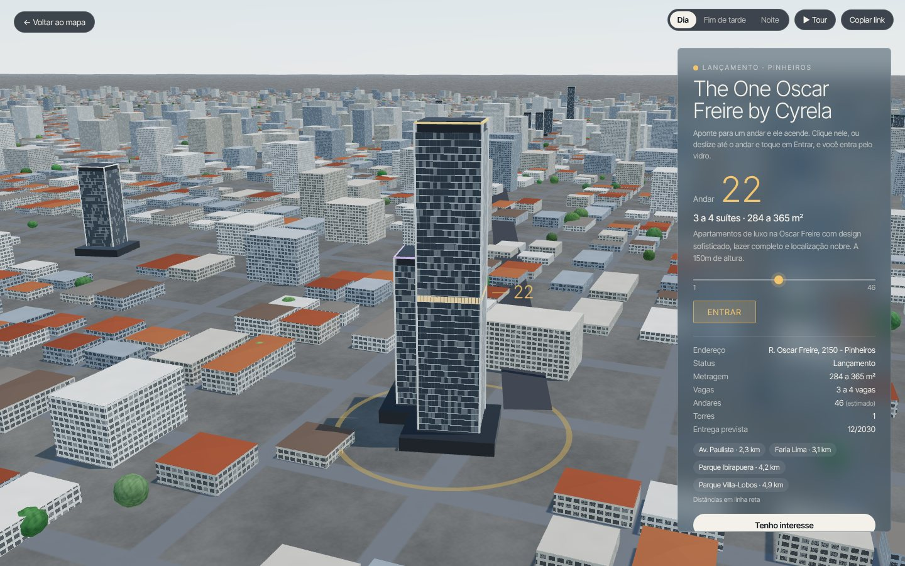

# Mapa 3D dos empreendimentos Cyrela em São Paulo

Uma São Paulo em 3D com os 80 empreendimentos Cyrela da capital posicionados pelas coordenadas reais. O cliente vê todos os prédios num lugar só, filtra, clica num prédio, escolhe o andar e "entra pelo vidro" no apartamento decorado, com a vista daquela altura.

Abra `cyrela-3d/index.html` num servidor (GitHub Pages, Netlify, Vercel ou `python3 -m http.server`). Com duplo clique (`file://`) não funciona.

## Como funciona

1. **Mapa:** relevo com o espigão da Paulista, rios Pinheiros e Tietê, parques, avenidas, Congonhas e marcos (MASP, estádios, Ponte Estaiada). Cada empreendimento tem um feixe de luz na cor do status e um marcador clicável.
2. **Lista e filtros:** busca por nome, bairro ou rua, com filtros de status (lançamento, em breve, em obras, pronto, 100% vendido), bairro e tipologia.
3. **Prédio ("Escolha o andar"):** aponte para um andar e ele acende. Também dá pra deslizar até o andar e tocar em **Entrar**. O painel mostra endereço, metragem, suítes, vagas, andares, entrega, a distância até Paulista, Faria Lima, Ibirapuera e Congonhas, e os botões "Tenho interesse" (WhatsApp do corretor), "Ver no site da Cyrela" e "Como chegar".
4. **Apartamento:** entrada com transição pela fachada, pontos clicáveis (Cozinha, Estar, Jantar, Varanda) e a vista real do modelo 3D naquele andar.

Extras: dia, fim de tarde e noite com a posição real do sol em SP, tour automático pelos prédios filtrados e link direto para um prédio (`…/cyrela-3d/#one-oscar-freire-cyrela`).

## Dados

- `data/empreendimentos.js` foi gerado a partir das páginas públicas de **cyrela.com.br/empreendimentos**, filtrando a cidade de São Paulo. De lá vêm nome, bairro, endereço, coordenadas, status, metragem, dormitórios, suítes, vagas, "100% vendido" e o link oficial.
- Andares, torres e previsão de entrega vêm do **apto.vc** quando foi possível casar o prédio com segurança (37 de 80). Nos outros prédios, os andares são **estimados** e o painel mostra "(estimado)".
- Consulta feita em 21/11/2026. Preços não foram incluídos, porque o valor de referência publicado não é confiável para mostrar ao cliente.
- Heritage Riviera ficou de fora, porque é em Porto Feliz e não na capital.

Para atualizar, edite `data/empreendimentos.js`. Cada prédio é um bloco com `nome`, `lat`, `lon`, `status`, `andares` etc.

## Personalizar

Em `js/config.js` ficam o nome do corretor, o CRECI e o **WhatsApp** que recebe o "Tenho interesse", além dos textos e das cores por status.

## Avisos

- Este é um mapa **independente**, sem a marca ou o logotipo da Cyrela, e o próprio site avisa isso no rodapé. Para usar com clientes, confirme se o seu contrato de parceria permite divulgar os empreendimentos dessa forma.
- A cidade, a volumetria dos prédios e os interiores são ilustrativos. A posição de cada empreendimento é a coordenada publicada pela Cyrela. Alguns produtos aparecem com a mesma coordenada no site oficial, e o mapa os agrupa lado a lado.
- As fotos e plantas oficiais não foram copiadas. O botão "Ver no site da Cyrela" leva à página de cada prédio.

## Tecnologia

[three.js](https://github.com/mrdoob/three.js) (MIT) e [SunCalc](https://github.com/mourner/suncalc) (BSD-2), sem etapa de build e sem depender de CDN.
