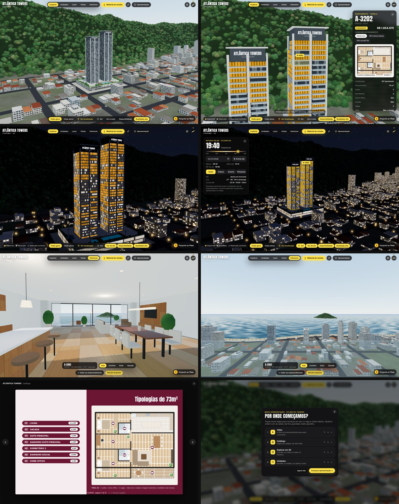

# Tour 3D imersivo de empreendimento

Site 100% em 3D (WebGL) para apresentar um empreendimento imobiliário: o prédio, a cidade, o mar e o morro em volta, com unidades clicáveis, estudo solar, vista real de cada andar, apartamento decorado, catálogo, filme e simulador de proposta.

Abra `imersivo/index.html` num servidor (GitHub Pages, Netlify, Vercel ou `python3 -m http.server`). Abrir com duplo clique (`file://`) não funciona por causa dos módulos JavaScript.

## O que tem

| Onde | Recurso |
|---|---|
| Topo | Explorar · Unidades · Lazer · Vistas · Interiores · Material de vendas · Copiar link · Apresentação · Bússola |
| Base | Visão geral · Visão aérea · Ver localização (mapa com pontos de interesse) · Sol · Ver à noite · Disponibilidade · Qualidade alta |
| Unidade | Clique numa unidade no prédio: aparecem código, status, preço, condições, planta humanizada, ficha, **Ver por dentro · 360°**, **Ver a vista** e **Simular proposta** |
| Espelho de vendas | Tabela andar × final por torre, com filtros e status por cor |
| Estudo solar | Sol e lua reais para a coordenada do empreendimento (biblioteca SunCalc), com horário, data, estações e animação do dia |
| Vistas | Câmera na sacada de qualquer andar ou orientação, na altura exata |
| Interiores | Apartamento decorado montado dentro da torre, na posição da unidade: o que se vê pela janela é a vista real daquele andar |
| Apresentação | "Por onde começamos?": Vídeo → Catálogo → Explorar em 3D → Unidades, com ordem ajustável e salva no aparelho |
| Catálogo | Book em tela cheia, com imagens renderizadas do próprio 3D e páginas de tipologia com planta |
| Filme | Filme cinematográfico gerado ao vivo no 3D, ou o seu vídeo (`videoUrl`) |
| Proposta | Valor ofertado, entrada, parcelas, reforços e permuta, enviados no WhatsApp do comercial, com cópia para o corretor, PDF e portal |
| Assistente | "Pergunte ao Theo": responde sobre preços, disponibilidade, lazer e entrega, e mexe no 3D |

Funciona no celular: os painéis viram gavetas na parte de baixo da tela e a qualidade se ajusta sozinha.

## Como personalizar

Quase tudo está em **`js/config.js`**:

- `nome`, `subtitulo`, `construtora`, `cidade`, `endereco`, `entrega`
- `lat` / `lon`: coordenadas reais do terreno (o estudo solar usa estas)
- `whatsappComercial`: número que recebe as propostas (só dígitos, com 55 + DDD)
- `portalConstrutora`: URL que recebe a proposta via POST JSON (vazio = modo demonstração)
- `videoUrl`: caminho de um .mp4 próprio (vazio = filme 3D automático)
- `precoM2Base`, `reajustePorAndar`, `premioVistaMar`, `condicoes`: tabela de preços
- `torres`: número de andares de cada torre
- `tipologias` e `COMODOS`: metragens, suítes e vagas, além dos cômodos usados no catálogo e na planta
- `statusFixo`: força o status de unidades específicas (as demais são geradas automaticamente; troque pela sua tabela real)
- `pois` e `lazer`: pontos do mapa e áreas de lazer

Link direto para uma unidade: `.../imersivo/?unit=A-3202`. Para abrir já no modo apresentação: `?apresentacao=1`.

## Tecnologia

- [three.js](https://github.com/mrdoob/three.js) r170 (MIT): renderização 3D, céu atmosférico, sombras e controles de câmera
- [SunCalc](https://github.com/mourner/suncalc) (BSD-2): posição astronômica do sol e da lua
- Sem build: HTML, CSS e JavaScript puro. As bibliotecas estão em `vendor/`, então o site não depende de CDN.

O relevo, a mata, a cidade, as torres, os interiores e as plantas são gerados por código. Para ter fachada e entorno fotorrealistas como no vídeo de referência, troque as torres procedurais pelo modelo 3D do arquiteto (`.glb`) e o entorno por fotogrametria ou Google Photorealistic 3D Tiles.
