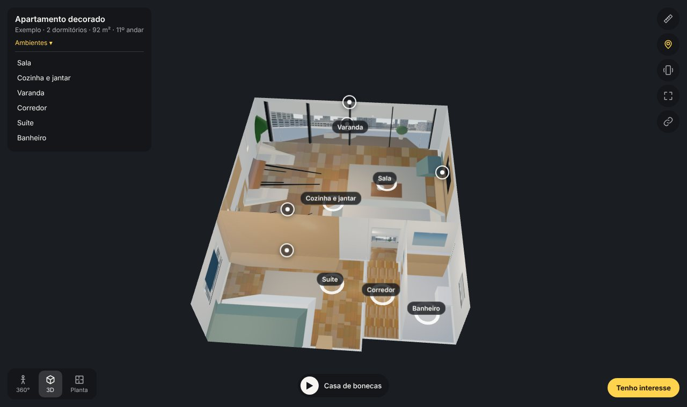

# Tour 360° (plataforma própria, estilo Matterport)



Você tira fotos 360° do imóvel, monta o tour no editor e publica um link. O cliente anda pelo imóvel ponto a ponto, vê a **casa de bonecas 3D** e a **planta**, mede ambientes e fala com você no WhatsApp.

- **Visualizador:** `tour360/index.html`. Abre o tour de exemplo, gerado em 3D.
- **Editor:** `tour360/editor.html`. É onde você monta os seus tours.

Os dois precisam de um servidor (GitHub Pages, Netlify ou `python3 -m http.server`). Abrindo com duplo clique não funciona.

## O que o cliente vê

| Recurso | Como funciona |
|---|---|
| Caminhada 360° | Arrasta para olhar e clica no piso ou nos círculos para andar até o próximo ponto. A transição dá a sensação de profundidade. |
| Joystick | A bolinha no canto: para frente anda até o próximo ponto na direção do olhar (segurando, continua andando), para trás volta e para os lados vira. No computador, setas ou W A S D. |
| Casa de bonecas (3D) | O imóvel inteiro sem teto, com as fotos projetadas nas paredes e no piso. Clicar num cômodo entra nele. |
| Planta | Vista de cima, também com as fotos. |
| Mini-mapa | Mostra onde você está e para onde olha. Clicar num ponto leva até ele. |
| Marcadores | Pontos com título e descrição (ex.: "Cozinha com ilha"). |
| Medir | Clica em dois pontos do piso ou das paredes e aparece a distância. |
| Tour automático | Gira em cada ambiente e passa para o próximo sozinho. |
| Celular | Toque e pinça para zoom. Num celular de verdade aparece o botão "mover o celular" (giroscópio), que ainda não foi testado. |
| Link direto | `…/tour360/#p5` abre já num ponto específico. |

## Como fazer um tour com o celular

1. **Fotos:** em cada ambiente, fique no meio do cômodo, com o celular a mais ou menos 1,5 m do chão, e tire uma foto 360°.
   - **Melhor resultado:** câmera 360° (Insta360, Ricoh Theta), que gera a foto completa num clique.
   - **Só com o celular:** app de foto esférica/360° (Photo Sphere no Android, ou um app de panorama 360° no iPhone). Gire sem sair do lugar.
   - Panorama comum (faixa larga) também funciona. O editor completa o teto e o piso com cinza.
2. **Editor:** abra `editor.html`, clique em **Abrir exemplo** para ver como funciona e depois em **Novo**.
3. **Suba as fotos** (arraste ou escolha). Cada foto vira um ponto.
4. **Posicione na planta:** arraste cada ponto até onde a foto foi tirada (a grade é de 1 m).
5. **Direção:** gire a seta amarela para onde a câmera apontava. Ou use **Alinhar com a planta**: deixe a porta no centro da prévia e clique na porta na planta.
6. **Cômodos:** em **Desenhar cômodo**, arraste o retângulo de cada ambiente. Isso dá a profundidade na caminhada e monta a casa de bonecas. Ajuste as medidas em metros na lista.
7. **Marcadores:** clique em **Adicionar marcador na prévia**, clique no ponto da foto e escreva o texto.
8. **Informações:** nome do imóvel, descrição, seu nome e WhatsApp.
9. **Publicar:** baixe o **pacote .zip**, descompacte e arraste a pasta em **app.netlify.com/drop**, ou suba no GitHub Pages. Sai um link pronto para mandar ao cliente.

O projeto fica salvo sozinho no navegador. Se fechar e abrir de novo, ele continua de onde parou.

## Diferença para o Matterport

O Matterport mede a profundidade de verdade (com câmeras próprias ou o LiDAR do iPhone) e monta um modelo 3D detalhado, com móveis. Aqui a profundidade vem dos cômodos que você desenha. Por isso, na casa de bonecas os móveis aparecem "pintados" no piso e nas paredes, mas o efeito geral é o mesmo, e você não paga assinatura.

## Estrutura

```
tour360/
  index.html          visualizador (lê o tour indicado em <meta name="tour">)
  editor.html         editor
  js/viewer.js        motor do tour (three.js)
  js/editor.js        editor (planta, fotos, exportação)
  data/demo/          tour de exemplo (tour.json + 6 fotos 360°)
  tools/              gerador das fotos de exemplo a partir do apartamento 3D
```

O formato `tour.json` traz os pontos (foto, posição em metros e rumo), os cômodos (retângulos em metros) e os marcadores (posição 3D). Para abrir outro tour no visualizador: `index.html?tour=caminho/tour.json`.

Bibliotecas: [three.js](https://github.com/mrdoob/three.js) (MIT) e, no editor, [JSZip](https://github.com/Stuk/jszip) (MIT, via cdnjs) para gerar o pacote.
